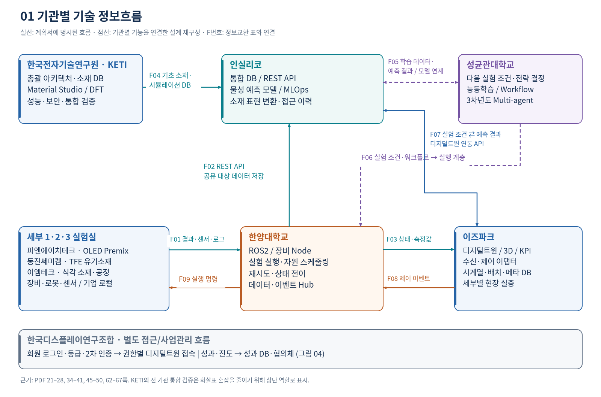
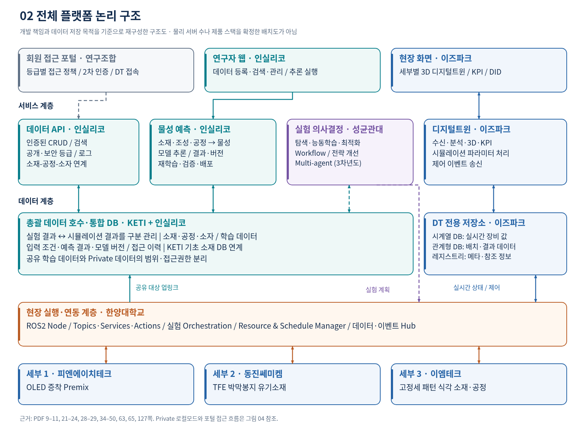
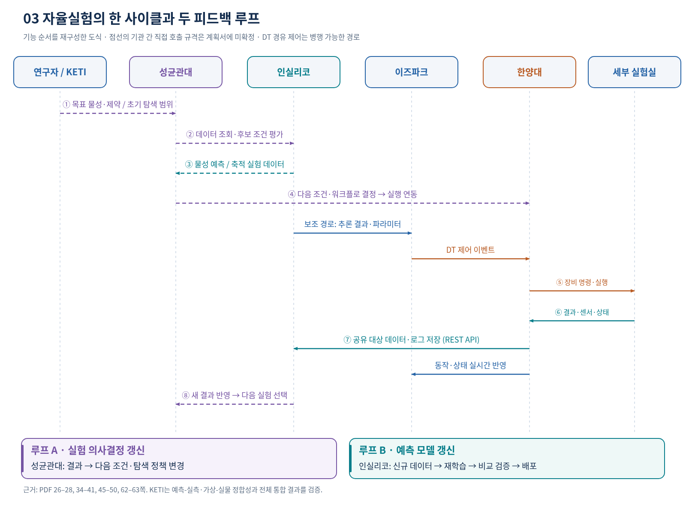
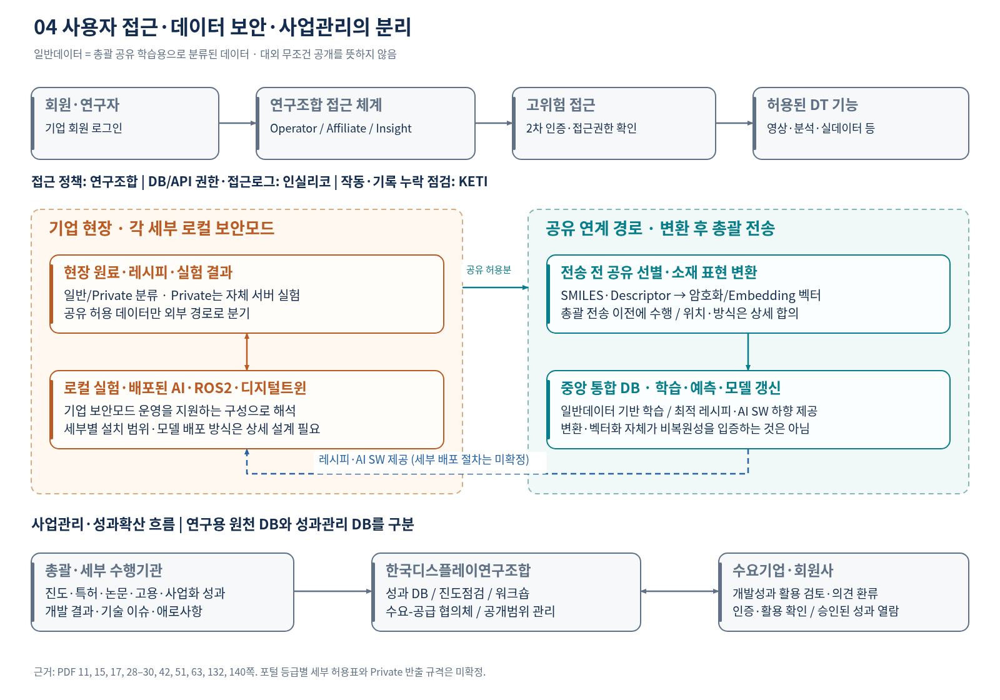

# 기관별 정보흐름 및 플랫폼 구조 분석

첨부 연구개발계획서 **RS-2026-25526544**를 바탕으로 작성한 13쪽 보고서와 그림·표입니다. 계획서의 명시 사항, 설명을 위한 설계 재구성, 확인이 필요한 내용을 구분했습니다.

## 다운로드

- **[전체 파일 ZIP](rd_platform_analysis.zip?raw=true)**
- **[13쪽 분석 보고서 PDF](report_ko.pdf?raw=true)**
- [단일 파일 HTML 보고서](report_ko.html?raw=true)
- [편집용 Markdown 본문](report_ko.md)
- [기관 간 정보교환 표 CSV](interface_matrix.csv?raw=true)

파일 화면에서 다운로드 아이콘 또는 **Download raw file**을 선택할 수도 있습니다.

## 그림

### 1. 기관별 정보흐름

[PNG](figures/01_institution_flow.png?raw=true) · [SVG](figures/01_institution_flow.svg?raw=true)

### 2. 전체 플랫폼 구조

[PNG](figures/02_platform_architecture.png?raw=true) · [SVG](figures/02_platform_architecture.svg?raw=true)

### 3. 자율실험 반복 과정

[PNG](figures/03_closed_loop.png?raw=true) · [SVG](figures/03_closed_loop.svg?raw=true)

### 4. 접근권한·보안·성과관리

[PNG](figures/04_access_security_governance.png?raw=true) · [SVG](figures/04_access_security_governance.svg?raw=true)

## 근거와 범위

- 근거 페이지는 원본 PDF의 파일 순번입니다. 본문 인쇄 쪽수는 대체로 PDF 순번보다 1 작습니다.
- 총괄 계획서에 근거한 구조 분석이며 실제 구축 완료·성능 달성 여부를 평가한 자료는 아닙니다.
- 세부과제별 별도 계획서에만 있는 내부 업무 분담은 확정하지 않았습니다.
- 그림 4종은 SVG·PNG로, 보고서는 PDF·HTML·Markdown으로 제공합니다.
- `source/`에는 산출물 생성 코드가 있습니다. 코드의 기본 경로와 실행 도구는 작성 당시 클라우드 환경 기준입니다.
