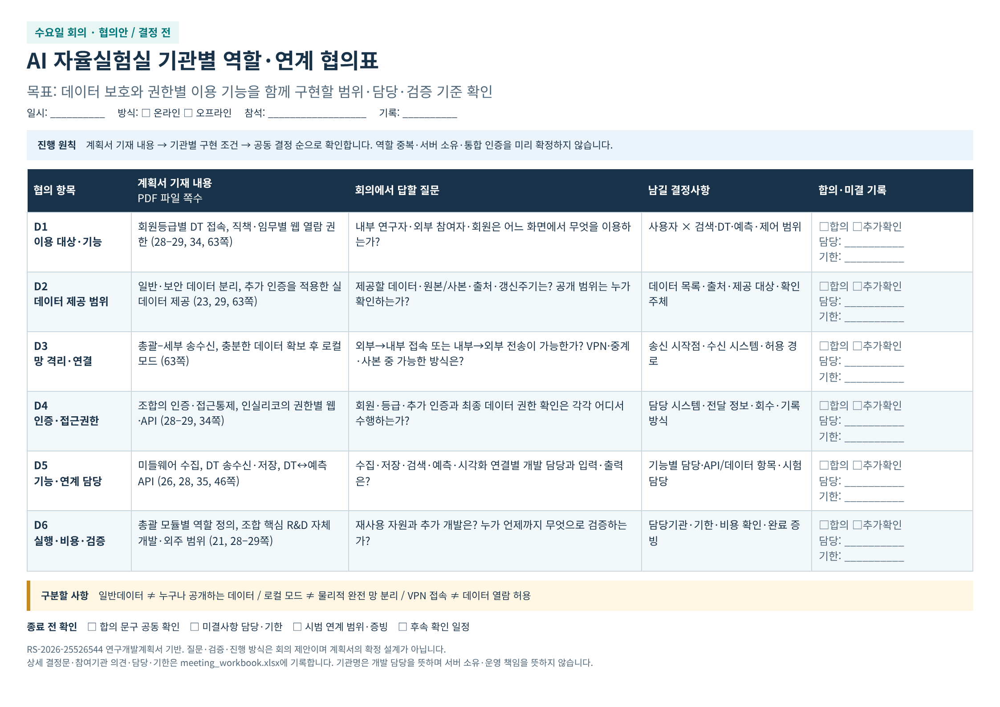

# 수요일 회의 준비자료

계획서의 기능과 기관별 구현 조건을 대조해 **적용 범위·연결 방식·담당·검증 기준**을 결정하기 위한 자료입니다. 회의 일시·방식·참석기관은 미정입니다.

- [1쪽 협의표 PDF](discussion_sheet.pdf) · [이미지](discussion_sheet.png)
- [회의 기록용 엑셀](meeting_workbook.xlsx): 협의표, 합의기록, 통신경로, 권한표, 비용검토, 검증체크
- [준비·진행안 PDF (2쪽)](meeting_prep.pdf) · [본문으로 읽기](meeting_prep.md)
- [전체 자료 ZIP](meeting_preparation.zip)

질문·참여기관·진행 시간·검증 기준·기술 대안은 회의 제안입니다. 기관 간 합의 또는 시험 완료를 뜻하지 않습니다. 기존 메일의 원문·연락처·미확정 기관 입장은 포함하지 않았습니다.

근거: RS-2026-25526544 연구개발계획서 PDF 파일 페이지 21, 23, 26, 28–29, 34–35, 46, 63쪽. 원문과 회의 결과를 함께 확인하세요.
