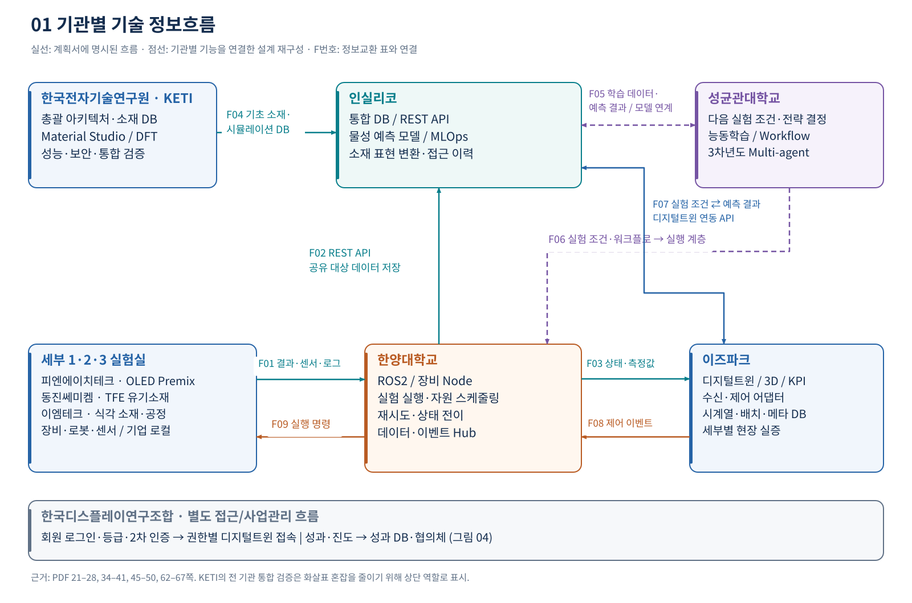
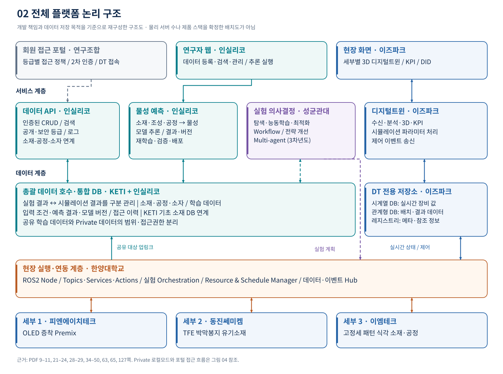
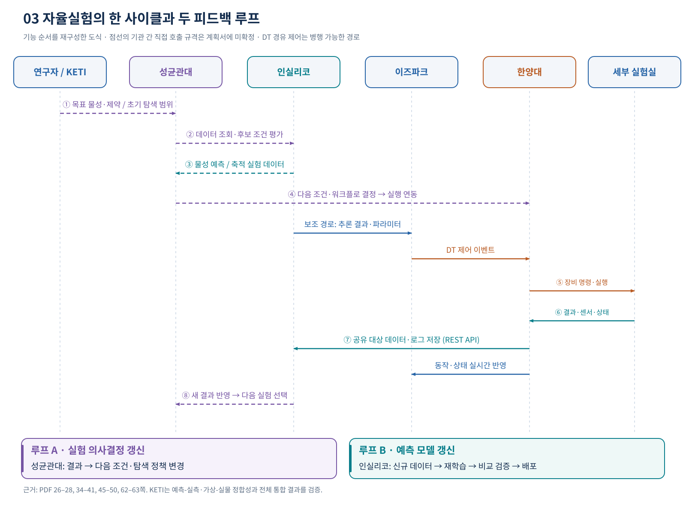
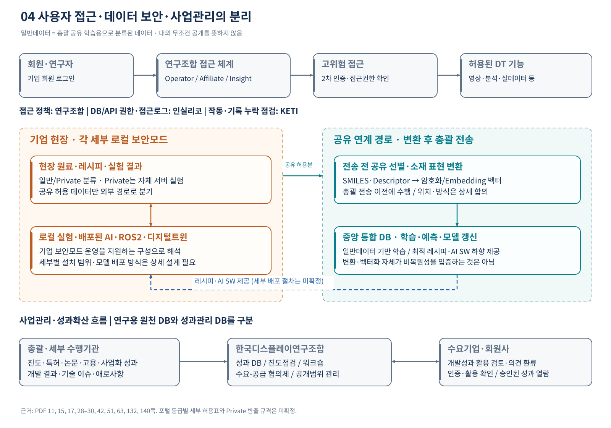

# 기관별 정보흐름 및 전체 플랫폼 구조

## 기관별 정보흐름과 전체 플랫폼 구조

AI 자율실험실용 가상공간 구축 및 디스플레이 소재 개발 플랫폼 기술 개발

### 3개 소재 실험실의 결과가 / 다음 실험과 예측 모델을 함께 개선하는 구조
총괄 6개 기관의 공통 플랫폼 + 세부 3개 실험실 + 회원 접근·성과확산 체계

### 데이터의 상향 흐름
세부 실험실 → 한양대 ROS2·Hub → 총괄 통합 DB / 이즈파크 디지털트윈

### 의사결정의 하향 흐름
성균관대 실험 조건·전략 / 인실리코 물성 예측 → 실행 연동 → 한양대 → 세부 장비

### 검증과 접근관리
KETI: 전체 구조·소재 DB·정합성 검증 / 연구조합: 회원 접근·진도·성과확산

해석의 핵심: 인실리코의 물성 예측, 성균관대의 실험 의사결정, 한양대의 장비 실행, 이즈파크의 디지털트윈을 구분한다. 전체 플랫폼을 단일 웹사이트나 단일 DB로 보면 책임과 정보 경계가 사라진다.
근거와 범위. 업로드된 협약용 통합형 총괄 계획서 141쪽을 대상으로 기술개발 본문·원문 도표·팀 편성도·수정대비표를 대조했다. 본문 인용은 PDF 순번 기준이다. 세부 1·2·3의 별도 계획서는 제공되지 않아 세부 참여기관의 내부 데이터 분담은 확정하지 않는다.

표시 원칙. 명시 문서에 적힌 역할·구성·흐름 / 재구성 명시된 기능을 연결한 논리 설계 / 확인 필요 구현 규격 또는 문서 내 불일치. 모든 수치는 개발 목표이며 달성 실적이 아니다.

## 기관별 책임과 정보의 소유 범위

| 총괄 수행기관 | 받는 정보 | 담당 기능·생산 정보 | 보내는 대상·결과 | PDF |
| --- | --- | --- | --- | --- |
| 한국전자기술연구원  KETI · 총괄 | 기존 실험·시뮬레이션, 세부 요구, 실측·예측, 보안·운영 로그 | 전체 아키텍처, 기초 소재 DB, AI 알고리즘·소재 표현 적합성 검토, 통합·보안·가상화 검증 | 각 개발기관·세부과제에 DB·방향·평가 피드백 | 21–22, 32–33, 44, 65, 67 |
| 인실리코 | 원료·조성·공정·실측, 시뮬레이션, 추론 조건 | 통합 DB·REST API·웹, 물성 예측 모델, MLOps, 소재 암호화 모듈, 접근 이력 | 데이터 서비스·예측 결과·모델을 AI/DT/세부에 제공 | 22–24, 33–38, 45–46, 65 |
| 이즈파크 | 장비 CAD·도면·시퀀스, 상태·센서, 시뮬레이션·추론 결과 | 실시간 3D·KPI, 전용 저장소·어댑터, 제어 이벤트, 현장 DT | 연구자·현장·권한 있는 회원에 화면; 미들웨어에 제어 이벤트 | 24–26, 38–39, 46–47 |
| 성균관대학교 | 실험 workflow·로그·센서·조건·결과, 축적 학습 데이터 | 표준 데이터, 탐색·능동학습, 다음 실험 결정, 상위 운영, Multi-agent·전략 개선 | 실행 계층에 실험 계획; 공통 저장소로 분석·학습 정보 환류 | 26–27, 39–41, 48–50 |
| 한양대학교 | 장비별 I/O·측정·상태, 실행 조건·시나리오·명령 | ROS2·Node, 순차/병렬 실행, 자원·일정, 재시도, 데이터·이벤트 Hub | 장비에 실행; DB·DT·AI에 결과·상태·이벤트 연계 | 28, 41, 50, 65, 67 |
| 한국디스플레이연구조합 | 회원 정보·접속 요청, 세부 진도·성과·애로, 수요기업 의견 | 등급별 접근·2차 인증·연동 규격 직접 개발, 성과 DB, 협의체·홍보 | 권한별 DT 접근; 총괄·세부·수요기업에 협의·성과 환류 | 28–30, 42, 51, 132, 140 |

### 세부 실험실과 참여기관의 범위

| 세부 / 주관기관 | 개발 대상 | 편성도에 기재된 참여기관 |
| --- | --- | --- |
| 1 / 피엔에이치테크 | OLED 증착 소재 사전 혼합(Premix) | 한국전자기술연구원, 경희대, 충남테크노파크, 삼성디스플레이 |
| 2 / 동진쎄미켐 | OLED 박막봉지(TFE) 유기소재 | 경기대, 성균관대, 고려대, 중앙대, 충남테크노파크, 삼성디스플레이 |
| 3 / 이엠테크 | 디스플레이 고정세 패턴 식각 소재·공정 | 한국전자기술연구원, 경상대(원문 표기), 연세대, 삼성디스플레이 |
세부 주관은 PDF 1쪽, 참여기관 목록은 PDF 66쪽(본문 65쪽). 세부 참여기관별 입력·출력·서버 운영자는 이 총괄 계획서만으로 특정할 수 없다. 같은 기관이 총괄과 세부에 함께 참여하더라도 책임 범위와 데이터 권한을 자동으로 동일시하지 않는다.

## 누가 누구에게 무엇을 보내는가

## 정보교환 목록 · 입력·출력·전달 목적

| ID | 보내는 쪽 → 받는 쪽 | 정보 / 산출물 | 경로·활용·확정 수준 | PDF |
| --- | --- | --- | --- | --- |
| F01 | 세부 1·2·3 → 한양대 미들웨어 | 실험 조건·결과, 센서값, 상태·로그 | 장비별 Node / ROS2 Topics. 장비 실행 결과를 표준화해 수집 | 28, 41, 50, 62 |
| F02 | 한양대 미들웨어 → 인실리코 통합 DB | 공유 대상으로 분류된 공정·실험 데이터 및 로그 | RESTful API 저장. 암호화·표현 변환 후 총괄 업링크 | 23–24, 34, 63 |
| F03 | 한양대 미들웨어 → 이즈파크 DT | 실시간 상태, 측정값, 장비 동작·이벤트 | 수신 어댑터 → 시계열 DB → 3D·KPI. Tag List로 항목 정의 | 25–26, 38–39, 46–47 |
| F04 | KETI → 공통 DB·AI 활용 계층 | Material Studio/DFT 기반 소재 특성·표준 학습 데이터 | 기초 DB 구축·갱신, 실험 데이터와 결합. 전송 규격은 미기재 | 21–22, 32–33, 60, 65 |
| F05 | 인실리코 데이터·예측 ↔ 성균관대 의사결정 | 축적 실험 데이터, 후보 조건, 예측 결과, 학습용 갱신 정보 | 기능상 필요한 연계로 재구성. 직접 호출 방식·공통 모델 범위는 미확정 | 26–27, 35–40, 48–49 |
| F06 | 성균관대 운영 계층 → 한양대 실행 계층 | 다음 실험 조건·순서, 워크플로, 재실행·전략 판단 | 상위 실험 결정과 장비 실행의 연결로 해석. 두 orchestration의 경계 합의 필요 | 39–41, 49–50, 67 |
| F07 | 이즈파크 DT ↔ 인실리코 추론 API | DT 실험 조건 → 예측 결과 | 조건 입력·결과 반환 API 명시. 입력 조건·추론 결과·모델 버전은 DB에 기록 | 34–35, 38–39, 46–47 |
| F08 | 이즈파크 DT → 한양대 미들웨어 | 시뮬레이션/화면 입력에서 유래한 제어 파라미터·이벤트 | DT가 제어 이벤트를 송신하고 미들웨어가 장비 명령으로 변환 | 11, 26, 47 |
| F09 | 한양대 미들웨어 → 세부 장비·로봇 | 실험 실행·설정·작업 명령, 실행 순서·자원 배정 | ROS2 Services/Actions 및 장비 Node. 재시도·대체 시나리오 지원 | 28 그림, 41, 50, 63 |
| F10 | 각 세부 → 이즈파크 | 장비 목록, 3D CAD·2D 도면, 배치·동작·Takt, KPI 요구 | DT 제작·현장 적용용 설계 자료. 실시간 센서 흐름과 구분 | 24–25, 39, 47 |
| F11 | 총괄 플랫폼 → 각 세부 | 최적 레시피, AI 분석 SW·학습 모델, 성능 개선 내용 | Down-link 및 현장 활용 명시. 패키징·배포·버전 전환 절차는 미정 | 15 그림, 33 그림, 44, 63 |
| F12 | 회원·연구자 ↔ 연구조합 접근 체계 ↔ DT | 인증·회원등급, 접근 요청, 허용된 영상·분석·실데이터 | 포털 연동·2차 인증. 세부 권한표·토큰 전달 규격은 미정 | 11, 28–29, 42, 51, 63 |
| F13 | 수행기관 → 연구조합 ↔ 수요기업·회원사 | 진도·특허·논문·사업화, 기술 이슈·수요 의견·활용 확인 | 성과 DB·협의체·워크숍·확산. 연구 원천데이터 수집과 별도 목적 | 17, 29–30, 42, 51, 132 |
F05·F06은 기관별 업무를 연결한 논리적 인터페이스이며 직접 API 호출 계약이 아니다. F11의 AI SW/모델 하향 제공은 원문 개념도에 있으나 배포 운영 규격은 명시되지 않았다.

## 플랫폼은 어떤 구성요소로 이루어지는가

## 저장소와 운영 책임을 구분한 상세 구조

| 구성요소 | 보관·처리할 정보 | 계획서상 담당 / 구조 해석 | 근거 PDF |
| --- | --- | --- | --- |
| 기초 소재 DB | Material Studio/DFT 시뮬레이션, 구조·광학·전기적 특성, 초기 학습 데이터 | KETI 구축·갱신. 통합 DB로 연결할 입력 자산 | 22, 32–33, 60, 130 |
| 데이터 호수 / 통합 DB | 소재-공정-소자, 실험·시뮬레이션, 권한·이력, 모델 추론 기록 | KETI + 인실리코 통합 플랫폼. DB/API 구현은 인실리코 | 14–15, 22–24, 33–35, 65 |
| 모델 관리·재학습 체계 | 모델 버전, 학습·평가 성능, 배포 대상, 모니터링 결과 | 인실리코 MLOps. 별도 제품명이나 독립 물리 DB는 미확정 | 24, 38, 45–46 |
| 실험 의사결정 공유 메모리 | 기획·실행 관리·분석·전략 Agent가 공유하는 데이터·의사결정 | 성균관대 3차년도 구상. 중앙 저장소와의 동일성·연계 방식은 미정 | 48–50 |
| DT 시계열 DB | 실시간 장비 수집값 | 이즈파크. 실시간 표시·3D 동기화 목적 | 46–47 |
| DT 관계형·레지스트리 DB | 배치/비주기 결과, 장비·공정 시나리오, 코드·분류, 메타데이터 | 이즈파크. 통합 DB와 별도 논리 저장 목적을 가진다 | 46–47 |
| 실험 데이터·이벤트 Hub | 현재 상태, 실행·측정 결과, 장비·실험 로그·이벤트 | 한양대. 실시간 실행·상태 통합의 책임; 별도 저장제품은 미기재 | 41, 50 |
| 회원·접속 및 성과관리 | 접근등급·정책·인증 흐름; 진도·특허·논문·고용·사업화 | 연구조합. 연구 원천 DB와 목적이 다른 업무 저장 영역으로 해석 | 28–30, 42, 51, 132 |
| 기업 Private 영역 | 기업 고유 원료·핵심 레시피 및 보안모드 실험 정보 | 기업 자체 서버/로컬모드. 배포·공유·권한 정책 상세 합의 필요 | 11, 63 |

### 물리 배치에 대해 문서가 말하는 범위

### 총괄
PDF 127쪽: KETI 내 DB 서버·AI 서버 설치 계획. “총괄 중앙 서버”는 PDF 63쪽에 명시.

### 각 실험실
PDF 47쪽: 각 세부 현장 DT 서버·DID 세팅. PDF 15쪽: 배포 AI SW·미들웨어·장비 구성.

### 아직 정해지지 않음
클라우드 사업자, HA·백업 배치, 네트워크 망 분리, 포털 호스팅, 서버·DB 간 복제 구조.

총괄 통합 DB가 DT 저장소·성과 DB·기업 Private 원본을 물리적으로 모두 흡수한다고 해석하지 않는다. 데이터셋 단위 원본 관리 책임과 동기화 방향은 상세 설계에서 합의해야 한다.

## 실험은 어떻게 반복되고 개선되는가

## 세부별 공유 데이터와 데이터 계약 초안

| 출처 | 올라오는 정보 | 돌아가는 정보 / 활용 | 근거 |
| --- | --- | --- | --- |
| 공통 | 원료 정보, 성분·배합비·공정조건, 센서·측정·장비 상태·로그 | 예측 물성, 후보 조성·최적 레시피, AI 분석 SW, 실험 조건·제어 | PDF 15, 62–63 |
| 1세부 · 피엔에이치테크 | Premix 배합비, 두께·굴절률·PL 특성 등 | 배합비별 물성 예측과 다음 조성·조건 추천 | PDF 35, 45, 62 |
| 2세부 · 동진쎄미켐 | TFE 유기소재·단량체/나노입자 배합비, 분산도·두께·유전율 등 | 봉지 소재 조성별 특성 예측과 후속 실험 추천 | PDF 35, 45, 62 |
| 3세부 · 이엠테크 | 식각액 조성·배합비, 두께·식각 bias·패턴 특성; 모델 예시에는 전도도도 제시 | 식각 소재·공정의 물성 예측과 조성·조건 추천 | PDF 35, 45, 62 |
| KETI 시뮬레이션 | Material Studio/DFT 계산값, 표준화된 기초 소재 데이터셋 | 초기 학습·후보 스크리닝, 실측과 예측의 검증 | PDF 22, 32–33, 60 |
예측 물성을 모두 개발한다고 단정하면 안 된다. PDF 35·45쪽은 각 세부에서 필요한 물성 중 연차별 모델을 선정하는 계획이다. 2차년도 세부당 1개, 3차년도 추가 1개로 누적 6개 모델을 목표로 한다.

### 기관 간 합의할 데이터 계약 · 아래 필드 묶음은 설계 제안

| 계약 영역 | 최소 합의 항목(제안) | 문서상 출발점 |
| --- | --- | --- |
| 실험·시료 식별 | 과제/기관, experiment_id, sample_id, recipe_id, 장비 ID, 원본 출처 | 소재-공정-소자 ENTITY와 세부별 스키마 (22–23, 33쪽) |
| 측정값·상태 | Tag ID, 의미, 자료형, 값·단위·정상범위, 측정시각, 갱신주기, 품질·오류 상태 | Tag List의 ID·설명·타입·범위·주기·중요도 (38쪽) |
| 실행 요청 | 요청 ID, 조건·단위, 순서·자원, 실행 허용범위, 취소·중단·실패 상태, 중복 실행 방지 | 순차/병렬 실행·재시도·Resource Manager (28, 41쪽) |
| 예측·학습 기록 | 입력 조건, 출력 물성, 모델 버전, 학습 데이터 버전, 평가 기준, 실측 연결 ID | 입력·추론 결과·모델 버전 저장 및 MLOps (35, 38, 45쪽) |
| 공유·권한 | 일반/Private 분류, 데이터 소유기관, 허용 목적·대상, 변환 방식·버전, 접근 이력 | 데이터 등급·접근로그·소재 표현 변환 (11, 23, 34, 63쪽) |
실험 원본, 시뮬레이션, AI 예측치를 서로 구분해 저장해야 평가 과정에서 예측값이 실측값으로 섞이지 않는다. 통합 검색 기능과 데이터 출처 분리는 함께 구현할 수 있다. 근거: PDF 9–10, 33–35쪽.

## 회원 접근·보안모드·성과관리의 정보흐름

## 접근 권한과 공개 범위를 어떻게 적용하는가

| 영역 | 계획서에 명시된 내용 | 책임과 해석 | 확정할 내용 |
| --- | --- | --- | --- |
| 회원 인증·등급 | 기업 회원 로그인, Operator / Affiliate / Insight, 단계별 권한, 고위험 구간 2차 인증 | 연구조합이 연동 규격·정책·인증 체계를 직접 개발 | 등급별 열람·다운로드·제어 권한표, 소속/과제별 범위 |
| 연구 DB·API | 직책·임무별 열람 차등, 인증된 사용자만 CRUD, 데이터 접근로그 | 인실리코가 플랫폼·API·웹에 적용, KETI가 검증 | 포털 인증과 API 인가의 전달·검증 방식 |
| 디지털트윈 | 구동 영상·실데이터 고위험 접근 추가 인증; 모니터링·분석·제어 기능 | 연구조합 접근체계와 이즈파크 DT 기능 연동 | 조회 권한과 장비 제어 권한의 구분, 현장 허용 조건 |
| 공유 학습 데이터 | 일반데이터는 총괄 공유 학습, 소재 구조 등은 변환된 벡터로 공유 | 인실리코 소재 변환/플랫폼 + KETI 적합성 평가 + 기업 분류 기준 | 공유 가능한 필드·기간·목적·재사용 범위, 변환 검증 |
| Private·로컬모드 | 기업 핵심 레시피는 자체 서버 실험; 충분한 총괄 학습 이후 보안모드 지원 | 기업별 보호 영역과 총괄 공유 영역을 분리 | 모델 반입·로컬 운영·로그 반출·결과 공유 경계 |
| 업무 성과 DB | 특허·논문·학술대회(반기), 고용·사업화·매출(연차), 진도·성과 추적 | 연구조합이 성과 수집·보고·협의체 운영 | 성과 공개 승인, 원천 실험 데이터와 연결 범위 |
| 수요기업 피드백 | 분석 결과 제공 및 활용의 유의미함을 이메일 등으로 확인하는 인증 계획 | 세부/총괄 성과 검증 + 연구조합 수요-공급 협의 지원 | 누가 어떤 자료를 제공하고 최종 활용 확인을 받는지 |

### 회원등급은 장비 제어권 자체가 아님
Operator 등의 명칭과 단계적 접근은 명시되어 있다. 명칭만으로 모든 장비·레시피에 대한 접근 권한을 배정할 근거는 부족하다.

### Embedding은 보안성 검증을 대체하지 않음
계획서는 암호화·Embedding·비식별 벡터를 함께 표현한다. 복원 위험, 키 관리, 변환 위치와 학습 유용성은 별도 검증 항목이다.

### 외주 범위는 웹 구현·유지보수
연구조합이 핵심 규격·정책·인증을 직접 설계·개발한다. 외주는 UI·퍼블리싱·연차별 수정·보완으로 제한된다.

근거: PDF 11, 17, 23, 28–30, 32, 34, 42, 51, 63, 65, 132, 140쪽. 데이터 접근은 목적·소속·과제 범위까지 함께 고려하는 상세 권한표가 필요하다.

## 연차별 연결 범위와 검증 목표

| 담당 / 축 | 2026 · 1차년도 | 2027 · 2차년도 | 2028 · 3차년도 |
| --- | --- | --- | --- |
| KETI | 전체 흐름·공유 시스템, 소재 코드 적합성, 기초 DB | DT·접근이력 점검, DB 기반 능동학습 적용·검증 | 알고리즘·보안 소재 예측·가상화 평가 및 개선 |
| 인실리코 | 통합 DB·API 프로토타입, 보안분류, MLOps 설계 | 통합 DB·웹·추론 API, 모델 3개, 자동 재학습 | 안정화·백업·알림, 모델 누적 6개, 재학습·배포 완성 |
| 이즈파크 | 범위·도면·KPI·연동 협의, 송수신 모듈 프로토타입 | Tag·어댑터 검증, 우선 1개 DT 프로토타입 | 공통 DT·저장소·3D·KPI, 3개 세부 적용·실증 |
| 성균관대 | 표준 데이터·파이프라인, Bayesian Optimization | 실험 운영·Workflow, 적응적 계획·폐루프 | Multi-agent, 전략 자기개선, 장기 자율운영 |
| 한양대 | 단일 장비 Node·Topic, 순차 실행 | 다중 장비·병렬 실행·동기화·자원·재시도 | 데이터·이벤트 Hub, 실제 환경 폐루프 실증 |
| 연구조합 | 접근·연동 설계, 협의체·성과 DB | 접속·권한 고도화, 진도·성과 관리 | 3개 DT 접속 검증·확립, 지속 운영·성과확산 |

### 정량 목표 · 성능목표표(PDF 16쪽)를 기준으로 기재

| 평가 항목 | 1차년도 | 2차년도 | 3차년도 | 해석 시 주의 |
| --- | --- | --- | --- | --- |
| 디지털트윈 수 / 물성 AI 모델 수 | — / — | 1 / 3 | 3 / 6 | 누적 개수. 모델은 R² > 0.85 기준 |
| 소재 예측 정합성 | — | 70% | 85% | AI 모델 수 산정의 R²와 다른 성능 지표 |
| 실험 가상화 구현율 | 30% | 70% | 85% | 본문 일부 90% 표현과 불일치; 최종 기준 확인 |
| 특성 최적화 소재 레시피 | — | 3종 | 9종 | 누적 목표 |
| 접근 제어·이력 관리율 | — | 80% | 100% | 권한 시나리오 및 실제 이벤트-로그 일치 평가 |
| 수요기업 인증 / AI 모델 평가 기준 | — / — | 1 / 1 | 3 / 3 | 각각 누적 개수 |
| 디지털트윈 동시성 지표 | — | — | ≤ 60ms | 대상 구간: DT 수신 시점 → 3D 렌더링 처리 명령 |
| 진도점검 / 협의체 | 각 1회 | 각 2회 | 각 2회 | 연별. 요약의 일부 연 2회 표현과 차이 |
연차별 기능 근거: PDF 20–51, 65쪽. 측정 방법: PDF 17–19쪽. ≤60ms는 전체 AI 추론·네트워크 왕복·로봇 동작 완료 시간의 목표가 아니다. 시험 대상은 선정된 1개 라인/장비 시나리오의 1,000개 이상 샘플 평균으로 제시되어 있다.

## 구현 전에 확인해야 할 경계와 문서 불일치

| 구분 | 계획서에서 확인한 상태 | 이번 도식의 처리 / 합의할 사항 | PDF |
| --- | --- | --- | --- |
| 기관 명칭 | 일정 그림에는 영남대 표기가 남아 있으나 본문·편성도·수정표는 한양대 | 한양대로 통일. 영남대를 별도 수행기관으로 추가하지 않음 | 53, 65, 67, 140–141 |
| 연구조합과 협회 | 공식 공동기관은 한국디스플레이연구조합. 편성도·포털 설명에는 협회 명칭 병기 | 개발 책임은 연구조합, 협회 회원 로그인은 연동 기반으로 구분 | 28–29, 66–67, 132 |
| AI·오케스트레이션 경계 | KETI·인실리코·성균관대 모두 AI 업무; 성균관대·한양대 모두 orchestration 표현 | 예측 서비스 / 실험 전략 / 실행 관리로 구분해 설명. 모델 소유·중단·재시도·제어 우선권 합의 | 32, 35–41, 44, 49–50, 67 |
| 중앙 DB·DT DB·Hub | 통합 DB, DT TSDB·관계형·레지스트리, 장비 Hub, 성과 DB가 각각 등장 | 동일 DB로 합치지 않음. 데이터별 원본 저장소·동기화 방향·보존기간 정의 | 23, 30, 46–50, 63 |
| 공유와 Private | 공통 학습 데이터 업링크와 기업 로컬모드가 모두 명시 | 필드별 반출 범위, 변환 위치, 로컬 AI 반입·업데이트, 데이터 재사용 범위 확정 | 11, 15, 63 |
| 암호화·Embedding | 문서는 비식별 벡터로 유출 방지를 지향하지만 구체 방식·키·위협모델은 미기재 | 보호 목적을 표현하되 보안 완성을 보증하지 않음. 복원 가능성과 모델 정합성 검증 | 21–22, 35, 63, 136 |
| 기술 스택 | Vue/Bootstrap, Spring Boot/Security/JPA, JWT, PostgreSQL, RDKit은 구성 “예시”; Unity/Unreal은 선정 예정 | 확정 제품으로 표시하지 않음. ROS2·RESTful API와 요구 기능을 기준으로 구조화 | 23 그림, 24, 46 |
| 실험 가상화 목표 | 목표표와 전략은 85%; 3차년도 설명은 90% 이상 | 목표표의 85%를 기준으로 표기하고 불일치 공개. 협약 KPI 확정 필요 | 16, 44, 60 |
| 세부 물성·지표 | 식각 예시는 전도도와 식각 bias·패턴이 병존. 정합성·R²·예측오차도 서로 다른 표현 | 세부별 예측 타깃, 단위, 시험 데이터, 산식·합격 범위 확정 | 16–18, 32, 35, 44–45, 62 |
| 기술 범위와 참고 기술 | 엣지 AI·지식그래프는 최신기술 검토 영역. 적용 예정으로 특정한 것은 C1~C3 | 엣지 AI·지식그래프를 필수 개발 모듈로 추가하지 않음 | 64 |
| 규격과 배포 | 기능·방향은 명시하나 endpoint·이벤트 스키마·재전송·HA·모델 배포계약은 부족 | 정보교환 표를 기준으로 기관 간 상세 인터페이스 명세 작성 필요 | 25–26, 34, 38, 41, 63 |
부록 PDF 130쪽 Material Studio 장비 계획에는 네트워크 패킷 캡처 사양 문구도 혼재한다. 본문에 일관되게 제시된 소재 시뮬레이션 용도만 구조에 반영했으며, 장비 사양 근거로 패킷 캡처 기능을 채택하지 않았다.

## 근거 색인과 산출물 활용 방법

| 근거 ID | PDF 순번 | 원문 위치 | 보고서에 반영한 사항 |
| --- | --- | --- | --- |
| S01 | 1, 66–67 | 표지·기술개발팀 편성도 | 총괄/세부 주관, 총괄 6개 기관, 세부 참여기관 목록 |
| S02 | 9–11, 14–15 | 개발 대상 정의·최종목표·총괄-세부 그림 | 양방향 순환, DB/API, 미들웨어, 보안·로컬모드, 배포 AI SW |
| S03 | 16–19 | 성능 목표·평가 방법 | 연차 목표, 정합성/모델 수 구분, 지연 측정 범위 |
| S04 | 21–24, 32–33, 44 | KETI/인실리코 개발 내용 | 기초 소재 DB, 전체 흐름, CRUD, 보안·검증 책임 |
| S05 | 24–26, 38–39 | 이즈파크 요구·연계·프로토타입 | CAD·Tag·수신 어댑터·제어 이벤트 경로 |
| S06 | 26–27, 39–41, 48–50 | 성균관대 데이터·알고리즘·운영 | 표준 데이터·탐색·상위 workflow·Agent·전략 개선 |
| S07 | 28, 41, 50 | 한양대 미들웨어·오케스트레이션·Hub | ROS2 Node·Topic·Services·Actions, 자원·재시도·상태 수집 |
| S08 | 28–30, 42, 51 | 연구조합 접근·성과관리 | 회원/2차 인증, 성과 DB, 협의체·홍보·접속체계 |
| S09 | 34–38, 45–46 | 인실리코 추론·예측 모델·MLOps | DT 조건↔예측 API, 모델 3→6, 재학습·버전·배포·모니터링 |
| S10 | 46–47 | 이즈파크 공통 시스템·데이터흐름 그림 | DT TSDB·관계형·레지스트리, 3D/KPI, 현장 서버·DID |
| S11 | 60–65 | 추진전략·데이터 공유·추진체계 | 공유 데이터 목록·ROS2/REST 업링크·다운링크·보안·기관별 역할 |
| S12 | 127, 130 | 설치·구매 계획 | KETI DB/AI 서버, Material Studio 도입·활용 범위 |
| S13 | 132, 140–141 | 외주 계획·협약 수정대비표 | 연구조합 직접 개발 vs 웹 외주, 한양대 변경, 수정 근거 |

### 회의·설계에 바로 사용할 산출물

### 네 가지 그림
① 기관별 기술 흐름 ② 플랫폼 계층 ③ 자율실험 순서 ④ 접근·보안·성과관리. SVG는 확대·편집, PNG는 발표자료 삽입에 사용.

### 기관 간 정보교환 표
F01–F13을 CSV로 제공. 협의 시 담당자·스키마·전달주기·권한·시험기준 열을 추가하면 인터페이스 명세의 출발점이 된다.

### 편집 가능한 보고서
HTML은 브라우저에서 열람·인쇄, PDF는 공유, Markdown은 내용 수정용. 생성용 Python 소스도 함께 제공.

전체 구조의 결론: 총괄의 데이터·AI·검증 플랫폼이 각 세부 실험실의 실행·측정·가상화와 양방향으로 연결되고, 연구조합의 권한·성과관리 체계가 그 위에서 접속과 확산을 관리한다. 기업 Private 모드는 이 연결의 별도 보안 경계다.
자료명: (RS-2026-25526544)1_2. 연구개발계획서(통합형 총괄)_협약용_클린본.pdf. 본 보고서는 계획서의 요구·역할을 분석한 결과이며, 별도 세부계획서·실제 구현 현황·기관 간 합의서는 검증 범위에 포함하지 않는다.
